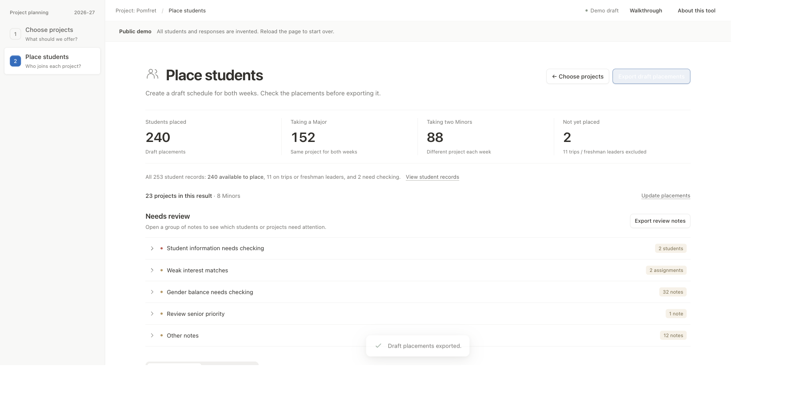

# Verification — October 27, 2026

This records checks of the repository integration. It does not certify a school roster or full compliance with the expanded build specification.

| Check | Observed result |
| --- | --- |
| Full local suite, Node 22.22.3 | 71 tests passed; no failures or skipped tests. |
| `npm run demo` | Committed Apps Script bundle ran practice generation → preparation → interest → sort → Check again in the spreadsheet simulator. |
| Practice result | 240 students placed: 152 Major, 88 Minor; 23 projects, including eight Minors. All four source tables stayed unchanged after generation. |
| Review tables | 36 PP tables exported to ignored `demo-output/`. Final PP Check retained 108 warnings and two informational findings, with no errors. Placement count alone is not approval: the deliberately broad fixture includes weak matches. |
| `npm run bundle` | Regenerated the three shared modules and single-file installation. Byte-for-byte parity is tested. Only the current-spreadsheet OAuth scope is declared. |
| `npm run build:demo` | Generated the 13-file public bundle from 253 invented records. Explicit allowlist and private-reference tests passed. |
| Browser check | Generated localhost demo loaded; all five walkthrough steps advanced and closed; project navigation and draft placement creation worked. Displayed 240 placed, 152 Major, 88 Minor, two review records and 11 exclusions. |
| Browser CSV | Downloaded draft placements; all 253 rows used invented student names. |
| Browser layout | Desktop screenshot reviewed; no horizontal page overflow. No new mobile-device trial was performed for this packaging change. |
| Privacy checks | Tests cover school addresses, school document links and personal filesystem paths in repository files, plus forbidden source-data filenames and public build boundaries. Screenshot contains practice counts only. |

## Rounds 1 and 2, October 28, 2026

Round 1 fixed what the first run on the real forms showed: shared emails, hand-typed rows, unreadable last-year answers, comments in shared tabs, Major labels and moves by hand. Round 2 added tie order, students who checked one project or none, leaders, the results summary, locks, friend requests, gender balance, Minor selection and Max size.

| Check | Observed result |
| --- | --- |
| Full local suite, Node 24.12.0 | 139 tests passed; no failures or skipped tests. Every rule in both rounds has Node tests with invented students at `example.org`. |
| `npm run demo` | 240 students placed: 152 Major, 88 Minor; 23 projects, including eight Minors. 38 PP tables exported. PP Check: no errors, 58 warnings, 2 informational findings. |
| Grade averages on practice data | Seniors 2.21, juniors 2.16, sophomores 4.24. Juniors averaging slightly better than seniors raises the existing review warning; the practice data is invented and broad. |
| `npm run build` | Bundle and the 253-record public demo rebuilt; the bundle's first line is still `/** @OnlyCurrentDoc */`. |
| Manifest | Two OAuth scopes: the current spreadsheet, and `userinfo.email` for Locked by and Run by. |

The identity rules from before round 1 (every shared email or unmatched row held for review) no longer apply. [SOURCE-AUDIT.md](SOURCE-AUDIT.md) describes the current rules.

## Not-sure rule and followChecksOverTrack, October 28, 2026

After round 2's fixes, the way Not-sure students are chosen for Minors changed (see [SOURCE-AUDIT.md](SOURCE-AUDIT.md)), and `followChecksOverTrack` was added.

| Check | Observed result |
| --- | --- |
| Full local suite, Node 24.12.0 | 160 tests passed; no failures or skipped tests. The new rule tests fail on the code from before each change, except the one checking that Minor-preference students, leaders and locks are placed as before. |
| `npm run demo` | 240 students placed: 144 Major, 96 Minor; 23 projects, including eight Minors. PP Check: no errors, 66 warnings (64 of them Fit 6), 2 informational findings. |
| Minor count on practice data | All 80 Not-sure practice students checked the same four Minors and four Majors, so they all lean Minor. 73 of them fill the Minors to the maximum of 96, and 7 do a Major. Before this change the fill stopped at the target of 88. |
| Grade results on practice data | Every senior and junior is in projects they checked, as before. Average fits: seniors 2.18, juniors 2.19, sophomores 4.71 (2.21, 2.19 and 4.21 before). 54 of 80 sophomores have nothing they checked, up from 42: 31 in a Major they didn't check (25 before) and 23 in two Minors they didn't check (17 before). Eight more Not-sure seniors now take seats in the four Minors every Not-sure practice student checked. The practice data is invented; check the real forms. |
| `followChecksOverTrack` on practice data | No practice student's answer disagrees with their checks, so PP Summary shows 0 and the setting changes nothing there. |
| `npm run bundle` | The bundle's first line is still `/** @OnlyCurrentDoc */`. |

## Max size and the gender pass, October 28, 2026

A Major's seats above its even split now go only to students who checked it, and the gender pass counts one student of a gender as worse than two and can move a single student (see [SOURCE-AUDIT.md](SOURCE-AUDIT.md)).

| Check | Observed result |
| --- | --- |
| Full local suite, Node 24.12.0 | 168 tests passed; no failures or skipped tests. The new Max size tests for checked-only seats and for the retry fail on the code from before the change, and the retry test also fails when the retry doesn't open those seats. All four new gender tests fail on the code from before. The 12-student test fails without the 12 cap, and the three-to-two test fails when a change that keeps the total the same is allowed. |
| Placements in existing tests | Every engine `sort` call the suite makes (206 on the old code) was recorded on the code from before both changes and after them. All 152 different inputs with no Max size and `balanceGender` off gave the same placements. Of 17 inputs with a Max size or `balanceGender` on, 5 changed, and all 5 come from the new tests. |
| `npm run demo` | Unchanged: 240 students placed, 144 Major, 96 Minor. PP Check: no errors, 66 warnings, 2 informational findings. The practice data has no gender data and no Max size. |
| Max size on practice data | With a Max size of 14 on the most checked Major, the group stays at its even split of 10, before and after. Most students who checked it are Not sure and do Minors, so no Major student is turned away from the extra seats. |
| Gender on practice data | With invented genders (half Female) and `balanceGender` TRUE, both versions end with no gender warnings. The old pass made 7 swaps; the new one makes 4 swaps and 3 moves, and sophomores' average fit goes from 4.71 to 4.64. With a quarter Female, both end with one group of two Female students that can't be fixed. |

The spreadsheet simulator implements the API methods used by the adapter, including data validation and cell writes; it is not Google Sheets. School-account authorization, actual Apps Script execution, real-source reconciliation, independent teammate review and Mr. Litowitz's approval remain outstanding. [SOURCE-AUDIT.md](SOURCE-AUDIT.md) lists the remaining gaps.

CI runs the tests, demo and build on Node 22 with Python 3.12, and fails if rebuilding changes committed Apps Script output. CI results must be read on the PR; defining the workflow is not evidence that a hosted run passed.
